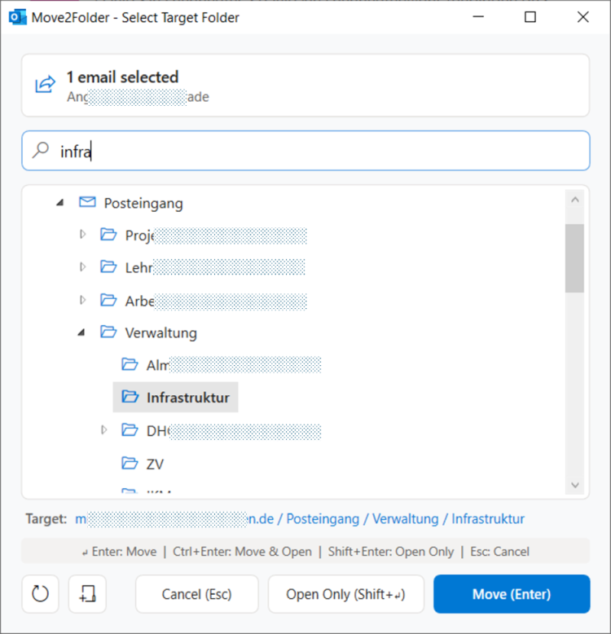

# Move2Folder - Outlook Classic Add-In

[](LICENSE)
[](https://dotnet.microsoft.com/)
[](https://microsoft.com/outlook)

**Move2Folder** is a fast, lightweight add-in for **Microsoft Outlook Classic (Desktop x64)**. It enables filing of selected email(s) or entire conversation threads into target folders using type-ahead search with automatic expansion of the folder tree, as well as rapid folder navigation. Invoke the add-in using the standard keyboard shortcut **`Ctrl + Shift + V`** or the Ribbon toolbar:



I developed this add-in with the help of Google Gemini because Outlook's built-in dialog to move a message to another folder without drag & drop is a disgrace to user interface design. There is no way to search for folders, no way to expand/collapse all (sub)folders with a keyboard shortcut or click, and the tree resets to fully collapsed after each restart of Outlook. This is possibly the worst modal dialog window across all Office applications.

---

## Features

- **Shortcut `Ctrl + Shift + V`**: Intercepts Outlook's slow built-in move dialog using an in-process Win32 thread hook and instantly displays the responsive Move2Folder search window instead.
- **Ribbon Integration**: Dedicated *"Move to Folder"* (*"In Ordner verschieben"*) button directly in the main Home tab (`TabMail`) and in opened email inspector windows (`TabReadMessage`).
- **Active Mailbox Scoping**: Folder search and tree view are automatically scoped to the **currently active mailbox** (e.g., primary Exchange account). Public folders or secondary mailboxes will not clutter your search results.
- **Conversation Support**: When selecting a conversation header in conversation view, all related emails belonging to the entire thread are automatically collected and moved together.
- **Direct Folder Navigation**: Can be triggered even when **no email is selected**, allowing you to quickly jump to any folder in your mailbox.
- **Type-ahead Search & Live Tree**: As you type in the search box, the folder tree dynamically filters in real time, auto-expands parent nodes, selects the best match, and scrolls it into view.
- **Smart Folder Memory**: Remembers the last used target folder per mailbox. When re-opening, that folder is pre-selected while the search box remains empty and immediately focused for typing.
- **Create New Folders On-the-Fly**: Right-click any folder or mailbox root in the tree view to open the context menu and select **"New Folder..."** (*"Neuer Ordner..."*), use the toolbar button, or press **`Ctrl + Shift + N`** (or `Insert` in the tree). A clean dialog with real-time validation lets you instantly create the folder in Outlook, pre-selects it, and allows immediate filing with `Enter`.
- **Automatic Bilingual Localization (DE / EN)**: Automatically detects Outlook's UI display language. Uses German for German Outlook installations, and English for all other languages.
- **Advanced Keyboard Navigation**:
  - `Enter`: Moves selected email(s) to the chosen folder (or switches to the folder if no email was selected).
  - `Ctrl + Enter`: Moves email(s) **and immediately switches to the target folder** in Outlook.
  - `Shift + Enter`: **Switches to the target folder only**, *without* moving any emails.
  - `Ctrl + Shift + N` / `Insert`: Creates a new subfolder in the selected folder.
  - `Esc`: Closes the window without action.
  - `Down / Up Arrows`: Quickly cycles through matching search results directly from the search box.
  - `F5`: Refreshes the folder list from Outlook.

---

## System Requirements

1. **Microsoft Outlook Classic (64-bit)** (Microsoft 365, Office 2021, 2019, or 2016 Click-to-Run)
2. **.NET 8 Windows Desktop Runtime (x64)** (Free download from [Microsoft .NET 8](https://dotnet.microsoft.com/download/dotnet/8.0))
3. **Windows 10 or Windows 11 (x64)**

> [!NOTE]
> **No administrator privileges required!** The add-in installs and registers completely within the current user profile (`HKEY_CURRENT_USER`).

---

## Installation and Usage

### For End Users (Ready-to-use Setup Package)
1. Download and extract **`Move2Folder-Setup.zip`**.
2. Close Outlook.
3. Double-click **`install.cmd`** (or right-click `install.ps1` -> *Run with PowerShell*).
4. Start Outlook Classic.
5. Press **`Ctrl + Shift + V`**.

### For Developers (Build & Register from Source)
```powershell
# 1. Clone / navigate to repository
cd move2folder

# 2. Build Release x64 and register for the current user
.\scripts\register.ps1

# 3. Create a distributable installer zip package
.\scripts\create_installer_package.ps1
```

The generated standalone package will be located at `dist\Move2Folder-Setup.zip`.

---

## Uninstallation

- Double-click **`uninstall.cmd`** included in the setup package (or run `.\scripts\unregister.ps1`).
- All registry keys under `HKCU` and installed files in `%LOCALAPPDATA%\Move2Folder` are cleanly removed without residue.

---

## Technical Details

- **Framework**: .NET 8 (`net8.0-windows`), C# 12, WPF
- **In-Process COM Hosting**: Powered by .NET Core native COM hosting (`EnableComHosting`) generating a 64-bit `Move2Folder.comhost.dll`.
- **COM Interfaces**:
  - `IDTExtensibility2` (Add-in lifecycle and connection management)
  - `IRibbonExtensibility` (Ribbon XML UI customization)
- **Keyboard Interception**: Win32 thread hook (`WH_KEYBOARD`) attached to Outlook's main UI thread. No system-wide global keyboard hooks are used; interception is active only while Outlook has window focus.
- **Configuration**: User settings (window dimensions, last used folder per mailbox) are persisted in `%APPDATA%\Move2Folder\settings.json`.

---

## License

This project is licensed under the [MIT License](LICENSE).
